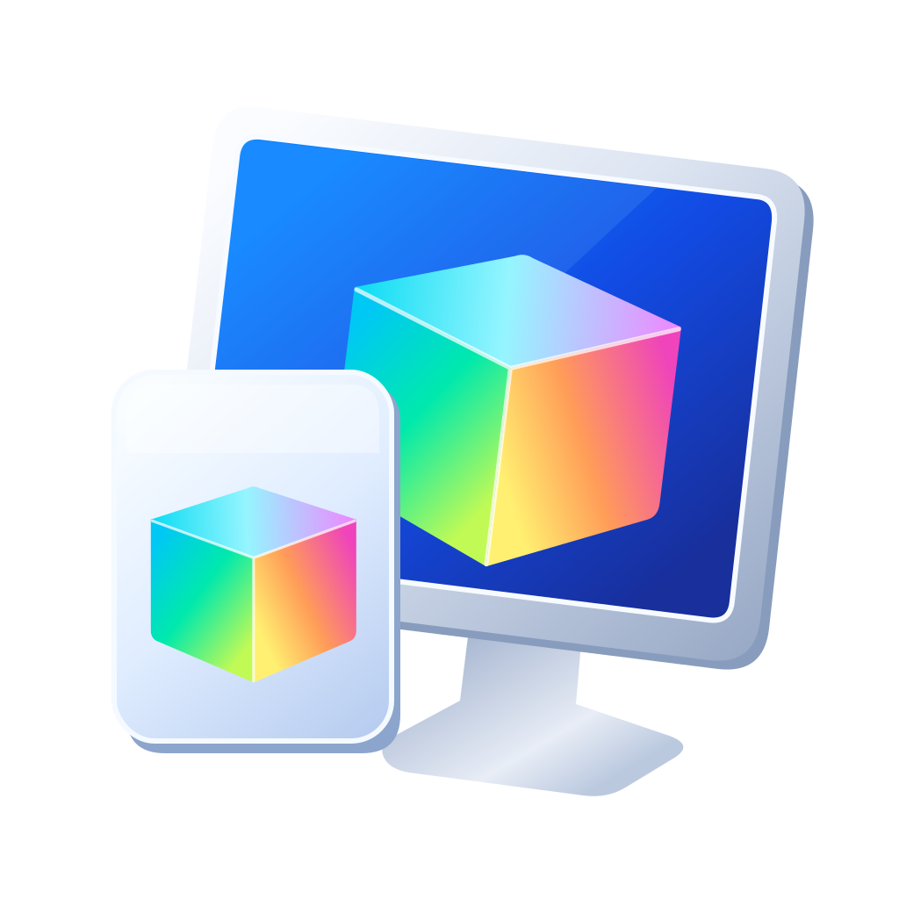

# DCCW++

Windows 11 的现代显示颜色校准工具。使用 WinUI 3，目标是让日常校准、多显示器预设管理和登录后恢复更清晰可靠，通过 Microsoft Store 发布。许可证：**GPL-3.0-only**。



## 当前状态：0.1 基础框架

已经实现：

- WinUI 3 原生窗口、系统主题、NavigationView、校准草稿、预设、参考照片和设置页面。
- 简体中文、繁体中文、英语；跟随系统、即时文字切换、英语回退和资源一致性测试。
- 本地预设保存、导入、导出；版本化 JSON、字段校验、大小上限、原子写入。导入不会自动应用。
- 显示器只读探测：活动拓扑、颜色模式（`sdr` / `wcg` / `hdr` / `advanced-color` / `unknown`）和当前 ICC 配置文件名。探测失败不会标成 SDR。当前 ID 只代表这次拓扑查询，不能作为跨端口持久身份。探测不写入配置文件，也不改变显示设置。
- 独立 CLI，与界面共用核心服务，支持 JSON 输出、退出码和预演。
- MSIX 清单、登录启动声明、CLI 执行别名、图标、多语言商店资源和构建脚本。

**尚未实现实际校准、前后效果对比、ICC 写入、自动恢复和崩溃回滚。** 颜色模式和当前配置文件名只是 Windows 的只读报告，不是测量或已生效的校准。界面和 CLI 会明确说明；`apply` 返回不可用，`apply --dry-run` 只返回计划。登录启动目前仅写入状态记录。

## 构建

需要 Windows 11、.NET SDK 10.0.4xx、PowerShell 7、Visual Studio 的 Windows 应用开发工具和 Windows SDK 26100。Windows App SDK 固定为已验证的稳定版 `1.8.260317003`。

```powershell
./scripts/Build.ps1 -Test
./scripts/Build.ps1 -Configuration Release -Package
```

第一条构建可直接运行的未打包应用和 CLI，并运行核心测试。第二条生成包含 CLI 的未签名开发 MSIX，输出至 `artifacts/packages/`。详细说明见 [商店发布](docs/STORE.md)。

```powershell
dotnet run --project src/DccwPlus.Cli -- status --json
dotnet run --project src/DccwPlus.Cli -- presets validate examples/neutral.dccw.json --json
```

安装包注册 `dccwpp.exe` 别名。未安装时可直接使用构建产物中的 `dccwpp.exe`。[命令行接口](docs/CLI.md)

## 结构

| 项目 | 责任 |
| --- | --- |
| `DccwPlus.Core` | 预设、校验、存储、国际化、校准服务边界 |
| `DccwPlus.Windows` | 显示器查询、Windows 启动接口，后续承载 ICC/WCS |
| `DccwPlus.App` | WinUI 3 界面、系统文件选择器、MSIX |
| `DccwPlus.Cli` | 控制台与 Agent 接口 |
| `DccwPlus.Core.Tests` | 数据边界、文件操作、语言和校准状态测试 |

开发顺序和验收要求见 [开发计划](docs/ROADMAP.md)。摄影素材要求见 [参考照片](docs/PHOTOGRAPHY.md)。

当前交付、验证结果与暂停位置见 [开发交接](docs/STATUS.md)。

## 参考与许可

界面参考 [微软 WinUI Gallery](https://github.com/microsoft/WinUI-Gallery) 的原生控件用法。工程打包参考本机 RunOnce；国际化参考 Clash# 的语言选择、回退和刷新机制，代码为本项目独立实现。项目不引用或运行这些应用，也不调用 `dccw.exe`。

GPL 全文见 [LICENSE](LICENSE)。本项目初始选择 GPL 3.0 only。发布时需同时提供对应版本源码、构建方式和依赖许可信息。摄影素材尚未加入，加入前单独记录作者及许可。
